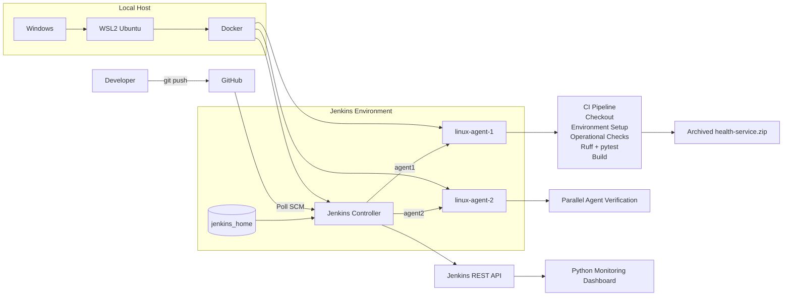
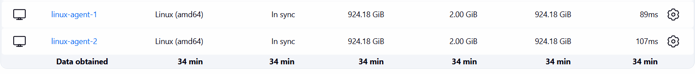
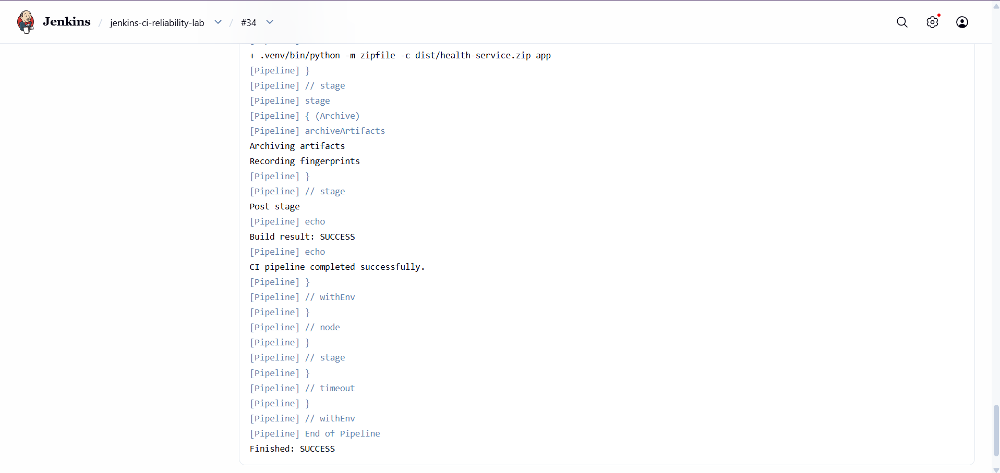
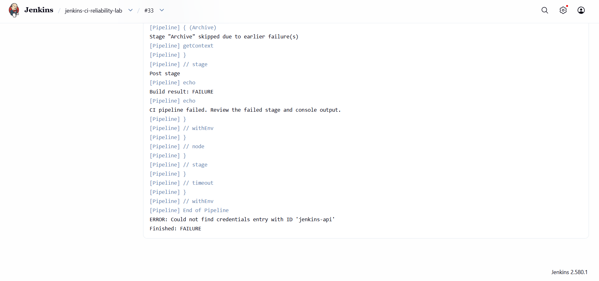
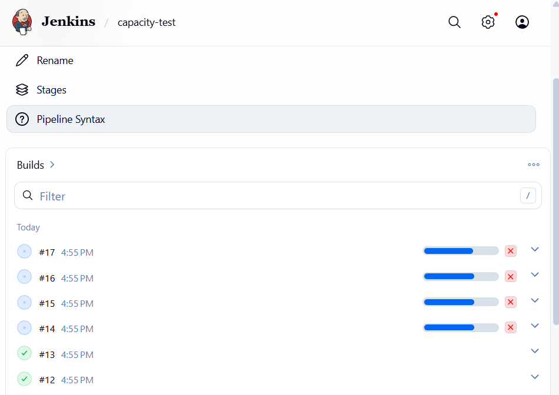
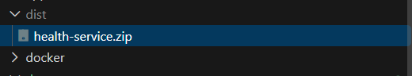
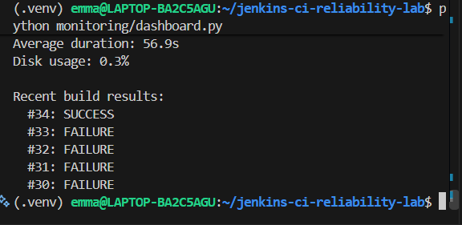

# Jenkins CI Reliability Lab

A hands-on Jenkins CI environment built to explore how continuous integration behaves under real operational conditions: distributed builds, constrained executor capacity, infrastructure failures, flaky tests, monitoring, secure credential handling and recovery.

The lab runs a Jenkins controller and two inbound Jenkins agents in Docker within WSL2 Ubuntu. A declarative Jenkins pipeline validates a small Python application while reliability experiments intentionally exercise agent outages, queue pressure, environment failures and infrastructure problems.

## Portfolio Summary

This project demonstrates practical Jenkins, CI/CD and reliability-engineering foundations through a working local environment rather than configuration examples alone.

It includes:

- Dockerized Jenkins controller with persistent storage
- two Docker-based Jenkins inbound agents
- distributed and parallel pipeline execution
- Jenkins Pipeline from SCM
- GitHub source-control integration
- Poll SCM automated builds
- Python CI with pytest and Ruff
- build parameters and environment validation
- Jenkins Credential Store integration
- infrastructure health checks and retries
- build and artifact retention
- archived and fingerprinted artifacts
- explicit CI failure classification
- executor and queue-capacity experiments
- Jenkins REST API monitoring
- operational troubleshooting and incident documentation

The focus of the project is CI reliability and operability rather than production deployment.

---

## Why I Built This

A basic Jenkins pipeline can run tests successfully while still being difficult to operate when something goes wrong.

I built this lab to understand questions such as:

- What happens when a Jenkins agent goes offline?
- Why does a build remain in the queue?
- What changes when a node has one executor versus several?
- When is retrying a failed CI operation appropriate?
- How can CI distinguish product failures from infrastructure failures?
- How should credentials reach a pipeline without entering source control?
- Which Jenkins state should survive container recreation?
- What information is useful when diagnosing CI incidents?

The project evolved from a simple Jenkins installation into a small CI reliability lab for answering those questions experimentally.

---

## Architecture




The Jenkins controller coordinates scheduling, job configuration, credentials, build history and agent management.

Normal build execution is delegated to containerized Jenkins agents.

Jenkins state is stored in the persistent `jenkins_home` Docker volume so the controller container can be recreated without losing configuration.

The controller and agents communicate through the `jenkins-lab` Docker network.

More detail is available in [`docs/architecture.md`](docs/architecture.md).

### Jenkins agents

The environment contains:

```text
linux-agent-1
linux-agent-2
```

The agents use labels including:

```text
agent1
agent2
python
linux
```

This allows Jenkins stages to request specific execution environments.

<!-- Add screenshot after capturing both agents online -->

<!--

-->

---

## Repository Structure

```text
.
├── app/
│   ├── __init__.py
│   └── health.py
├── tests/
│   └── test_health.py
├── scripts/
│   ├── check_disk.sh
│   └── check_jenkins.py
├── monitoring/
│   └── dashboard.py
├── docker/
│   └── agent/
│       └── Dockerfile
├── docs/
│   ├── architecture.md
│   ├── incident-runbook.md
│   ├── jenkins-admin.md
│   ├── lessons-learned.md
│   ├── pipeline-design.md
│   ├── troubleshooting.md
│   └── screenshots/
├── Jenkinsfile
├── Jenkinsfile.capacity
├── requirements.txt
├── .gitignore
└── README.md
```

---

## CI Workflow

The main Jenkins job uses Pipeline from SCM and polls the GitHub repository for changes:

```text
H/2 * * * *
```

The current workflow is:

```text
GitHub change
      ↓
Jenkins detects new SCM revision
      ↓
Verify both Jenkins agents in parallel
      ↓
Checkout
      ↓
Create Python virtual environment
      ↓
Install pinned dependencies
      ↓
Validate environment
      ↓
Validate Jenkins credentials
      ↓
Operational checks
      ├── Disk capacity
      └── Jenkins connectivity
      ↓
Quality checks in parallel
      ├── Ruff
      └── pytest
      ↓
Build ZIP artifact
      ↓
Archive + fingerprint artifact
```

The pipeline uses:

```groovy
agent none
```


at the top level so individual stages explicitly request the execution environment they need.

See [`Jenkinsfile`](Jenkinsfile) and [`docs/pipeline-design.md`](docs/pipeline-design.md).

<!-- Add successful pipeline screenshot here -->

<!--

-->

---

## Distributed Builds

The pipeline verifies both Jenkins agents in parallel before the main CI workflow runs.

This demonstrates:

- multiple Jenkins nodes
- label-based agent selection
- parallel Jenkins stages
- distributed build execution
- executor scheduling across agents

The controller coordinates the work while the agents provide execution capacity.

---

## Python CI Workload

The application itself is intentionally small because the focus of the repository is CI infrastructure rather than application complexity.

The Python service exposes a simple health result containing:

- version
- hostname
- UTC timestamp
- health status

pytest validates application behaviour, while Ruff provides linting.

The pinned CI dependencies are stored in:

```text
requirements.txt
```

---

## Reliability Engineering

The pipeline includes several controls intended to improve reliability and CI signal quality.

### Pipeline timeout

The main pipeline has a ten-minute timeout.

This prevents a stalled or blocked build from consuming Jenkins resources indefinitely.

### Controlled concurrency

Concurrent executions of the same main pipeline are disabled.

Capacity behaviour is tested separately using the dedicated capacity pipeline.

### Build retention

Jenkins retains a limited number of builds and artifact sets.

The pipeline keeps:

```text
20 builds
10 artifact sets
```

This prevents Jenkins storage from growing indefinitely.

### Infrastructure retries

The Jenkins connectivity check is retried because short infrastructure or networking failures can be transient.

Product tests are intentionally not automatically retried.

A deterministic application failure should remain red until the underlying issue is corrected.

### Persistent controller state

Jenkins state is stored in:

```text
jenkins_home
```

rather than relying on the lifetime of the controller container.

This allows the controller container to be replaced while preserving Jenkins configuration.

### Dependency pinning

Python CI tools are pinned to explicit versions to improve reproducibility.

### Multiple agents

Two Jenkins agents provide distributed execution and allow capacity behaviour to be explored beyond a single node.

---

## Failure Classification

CI failures are grouped into three categories:

```text
PRODUCT
INFRASTRUCTURE
DEPENDENCY_OR_ENVIRONMENT
```


### PRODUCT

Examples:

- pytest failure
- Ruff violation
- application regression

### INFRASTRUCTURE

Examples:

- Jenkins controller unavailable
- Jenkins agent offline
- Docker networking failure
- disk-capacity failure

### DEPENDENCY_OR_ENVIRONMENT

Examples:

- virtual-environment setup failure
- package installation failure
- invalid execution environment

The purpose is to make a red pipeline easier to interpret and troubleshoot.

---

## Failure Experiments

Several failures were intentionally introduced while developing the lab.

| Experiment | Lesson |
| --- | --- |
| Application test regression | Product failures should stay visible rather than being hidden by retries. |
| Offline Jenkins agent | Agent availability directly affects scheduling and distributed execution. |
| Missing environment variable | CI should validate required environment state early. |
| Jenkinsfile syntax failure | Pipeline-definition problems can fail before normal application execution begins. |
| Python syntax failure | Automation scripts themselves require validation and clear diagnostics. |
| Shell comparison error | Small shell errors can become CI operational failures. |
| Jenkins connectivity failure | Container networking and service addressing directly affect infrastructure checks. |
| Flaky test | Nondeterministic tests reduce confidence in CI results. |
| Constrained executor capacity | Busy executors create queues even while Jenkins is otherwise healthy. |

More detailed troubleshooting examples are documented in [`docs/troubleshooting.md`](docs/troubleshooting.md).

<!-- Add deliberate failure screenshot here -->

<!--

-->

---

## CI Signal Quality

A useful CI failure should help answer:

```text
What failed?
Where did it fail?
Is it application code or infrastructure?
Should the operation be retried?
What evidence was retained?
```

The project uses stage boundaries, failure classification, console output and archived artifacts to make pipeline results easier to interpret.

Flaky-test behaviour was also explored because repeatedly rerunning unreliable tests until they pass produces a misleading CI signal.

---

## Capacity and Scaling



A separate pipeline is provided in:

```text
Jenkinsfile.capacity
```

It records:

- executing agent
- CPU-core count
- available memory
- disk usage

It then performs simulated work long enough to occupy an executor.

The experiments explored:

- one executor
- multiple executors
- multiple Jenkins agents
- queued builds
- parallel workloads
- resource contention

One of the most important conclusions was:

> A Jenkins executor is a scheduling slot, not additional hardware.

Increasing executor count allows more tasks to be scheduled concurrently but does not create additional:

- CPU
- RAM
- disk
- network capacity

Too many executors can therefore increase resource contention.

Adding another agent can provide additional execution capacity when that agent has separate available resources.

<!-- Add queue/executor screenshot here -->

<!--

-->

---

## Build Artifacts



After CI checks succeed, the application is packaged as:

```text
dist/health-service.zip
```

Jenkins archives the ZIP using artifact fingerprinting.

Generated build output is excluded from Git because source control should contain the inputs required to reproduce a build rather than generated artifacts.

<!-- Add archived artifact screenshot here -->

<!--

-->

---

## Monitoring



`monitoring/dashboard.py` uses the Jenkins REST API to provide lightweight operational visibility.

It reports:

- Jenkins availability
- online agents
- offline agents
- queue size
- recent builds
- failed builds
- average build duration
- local disk usage

The dashboard supports Jenkins API-token authentication through environment variables.

It is intentionally a small operational tool rather than a replacement for a full monitoring platform.

Example:

```text
Jenkins CI Reliability Dashboard

Jenkins status: ONLINE
Online agents:  2
Offline agents: 0
Queue size:     ...
Recent builds:  ...
Failed builds:  ...
Average duration: ...
Disk usage:     ...
```

<!-- Add monitoring screenshot here -->

<!--

-->

---

## Operational Automation

### Jenkins health check

`scripts/check_jenkins.py` performs an HTTP reachability check against the Jenkins controller.

It uses a request timeout and exits non-zero if Jenkins cannot be reached.

The pipeline retries this check because connectivity failures may sometimes be transient.

### Disk capacity check

`scripts/check_disk.sh` measures disk utilisation against a configurable threshold.

The default threshold can be overridden using:

```text
DISK_THRESHOLD
```

If usage reaches or exceeds the threshold, the script exits non-zero and Jenkins treats the operational check as failed.

---

## Security

Credentials are not stored directly in the repository.

Security practices demonstrated in the lab include:

- Jenkins Credential Store
- Jenkins API-token authentication
- scoped credential injection using `withCredentials`
- environment-variable based credential use
- Jenkins secret masking
- inbound-agent secret rotation
- separation of credentials from Git
- least-privilege thinking

The main pipeline receives temporary variables such as:

```text
JENKINS_USER
JENKINS_API_TOKEN
```

without storing the real values in the Jenkinsfile.

Agent connection secrets and API tokens should never be committed to source control or exposed in screenshots.

If a credential is exposed:

1. treat it as compromised
2. rotate it
3. invalidate the previous value
4. inspect Git history
5. inspect logs and screenshots
6. verify the replacement credential
7. do not reuse the compromised credential

This project does not claim to implement an enterprise secrets-management platform. It demonstrates safe Jenkins credential-handling practices within the scope of the lab.

---

## Jenkins Administration

Operational procedures are documented in:

[`docs/jenkins-admin.md`](docs/jenkins-admin.md)

Topics include:

- controller lifecycle
- persistent storage
- agent lifecycle
- executor behaviour
- build queues
- credentials
- agent-secret rotation
- Docker networking
- operational health checks

---

## Incident Response

The project includes a structured Jenkins incident runbook.

The basic process is:

```text
Confirm incident
      ↓
Classify failure
      ↓
Check controller
      ↓
Check agents
      ↓
Inspect queue
      ↓
Inspect resources
      ↓
Inspect networking
      ↓
Review recent changes
      ↓
Recover safely
      ↓
Validate recovery
      ↓
Record lessons
```

See [`docs/incident-runbook.md`](docs/incident-runbook.md).

---

## What I Learned

The main technical lessons from this project were:

- Jenkins controllers coordinate work while agents execute it.
- Agent labels determine where workloads can run.
- Executors represent scheduling capacity rather than physical resources.
- Queue growth is an operational signal and does not automatically mean Jenkins is unhealthy.
- Adding executors is different from adding agents.
- Docker networking changes what `localhost` means.
- Persistent volumes separate important Jenkins state from disposable containers.
- Application failures and infrastructure failures require different troubleshooting paths.
- Retries should target transient infrastructure failures rather than deterministic product failures.
- Flaky tests reduce confidence in CI.
- Generated build artifacts belong in CI artifact storage rather than Git.
- Build retention prevents unlimited storage growth.
- Monitoring improves troubleshooting by exposing system state before changes are made.
- Credentials should be injected only when required and should never be committed.
- Failure classification improves incident response.
- Reliable CI requires operational engineering in addition to a working Jenkinsfile.

More detail is available in [`docs/lessons-learned.md`](docs/lessons-learned.md).

---

## Technology Stack

- Jenkins
- Declarative Jenkins Pipeline / Groovy
- Docker
- WSL2 Ubuntu
- Linux
- Git
- GitHub
- Python
- pytest
- Ruff
- POSIX shell
- Jenkins REST API

---

## Documentation

| Document | Purpose |
| --- | --- |
| [`architecture.md`](docs/architecture.md) | Runtime and CI architecture |
| [`jenkins-admin.md`](docs/jenkins-admin.md) | Jenkins administration and node operations |
| [`pipeline-design.md`](docs/pipeline-design.md) | Pipeline design decisions |
| [`troubleshooting.md`](docs/troubleshooting.md) | Symptoms, causes and troubleshooting steps |
| [`incident-runbook.md`](docs/incident-runbook.md) | Structured incident-response process |
| [`lessons-learned.md`](docs/lessons-learned.md) | Technical conclusions from the reliability experiments |

---

## Project Scope

This repository is a local CI reliability lab.

It does not claim:

- production infrastructure
- Kubernetes
- AWS, Azure or GCP
- Terraform
- enterprise-scale Jenkins
- production SRE experience

The purpose is to demonstrate practical Jenkins, Docker, Linux, CI, troubleshooting, monitoring and reliability-engineering foundations through hands-on experiments.

---

## Project Status

The implemented lab currently covers:

- Dockerized Jenkins controller
- persistent Jenkins storage
- two inbound Docker agents
- distributed Jenkins execution
- automatic SCM polling
- declarative Jenkins pipeline
- Python virtual environments
- Ruff linting
- pytest testing
- parallel stages
- pipeline parameters
- Jenkins credentials
- infrastructure retries
- pipeline timeout
- build retention
- artifact retention
- archived build artifacts
- failure classification
- capacity experiments
- queue and executor testing
- Jenkins REST API monitoring
- troubleshooting documentation
- incident-response documentation